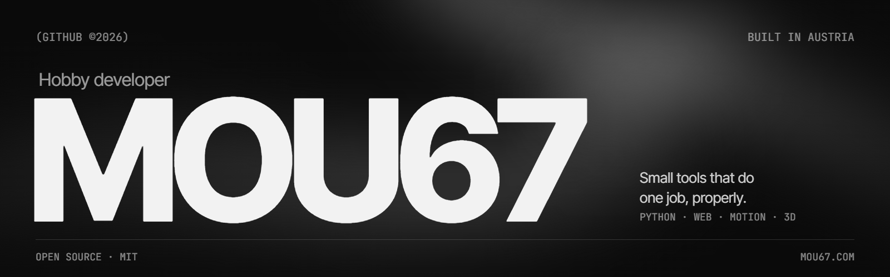

<!-- GitHub profile README · black & white, matches mou67.com -->

<a href="https://mou67.com">
  <picture>
    <source media="(prefers-color-scheme: dark)" srcset="assets/banner-dark.png" />
    <source media="(prefers-color-scheme: light)" srcset="assets/banner-light.png" />
    
  </picture>
</a>

  <picture>
    <source media="(prefers-color-scheme: dark)" srcset="https://readme-typing-svg.demolab.com?font=JetBrains+Mono&size=18&duration=2800&pause=1200&color=F2F2F2&center=true&vCenter=true&width=640&lines=Hobby+developer+from+Austria;Python+tools+that+do+one+job%2C+properly;Front-end+%C2%B7+Motion+%C2%B7+3D+in+Blender" />
    
  </picture>

 

### `01` — About

I'm **Mou67**, a hobby programmer from Austria. I build things for myself: small Python tools that take over some task I got tired of doing by hand, and websites with motion and a clean, reduced design. When one of them actually works, it goes public on GitHub.

<table>
  <tr><td><code>based in</code></td><td>Austria</td></tr>
  <tr><td><code>building</code></td><td>Python tools · websites · 3D models in Blender</td></tr>
  <tr><td><code>website</code></td><td><a href="https://mou67.com">mou67.com</a></td></tr>
</table>

 

### `02` — Selected work

| Project | What it does | Stack |
| ------- | ------------ | ----- |
| **[Patreon Audio Downloader](https://github.com/Mou67/Patreon-Downloader)** | Downloads Patreon content you have access to and converts it to MP3. Session-ID login, live progress bar, ships as a standalone `.exe`. | `Python` `tkinter` `yt-dlp` `FFmpeg` |
| **[SpecterMonitor](https://github.com/Mou67/SpecterMonitor)** | Keeps an eye on things that shouldn't be watched by hand. Runs in the background and says something when the state changes. | `Python` `Automation` |
| **[mou67.com](https://mou67.com)** | My black & white portfolio: liquid chrome hero, scroll-driven 3D project showcase, smooth scrolling. | `React` `TypeScript` `GSAP` `Lenis` |

 

### `03` — Stack

  
  
  
  
  
  
  
  
  
  
  

 

### `04` — How I work

**Scratch my own itch.** Every tool starts as something I personally needed. One clear job per project, nothing added to look impressive.

**Make it survive a stranger.** Real error messages, a progress bar you can trust, and a README that answers the questions people actually hit.

**Put it on GitHub.** Packaged, MIT-licensed, pushed public. If it helped me, it might help someone else.

 

### `05` — Numbers

  <picture>
    <source media="(prefers-color-scheme: dark)" srcset="https://github-readme-stats.vercel.app/api?username=Mou67&show_icons=true&hide_border=true&border_radius=0&bg_color=0a0a0a&title_color=f2f2f2&text_color=9a9a9a&icon_color=f2f2f2&ring_color=f2f2f2" />
    
  </picture>
   
  <picture>
    <source media="(prefers-color-scheme: dark)" srcset="https://streak-stats.demolab.com?user=Mou67&hide_border=true&border_radius=0&background=0A0A0A&stroke=333333&ring=F2F2F2&fire=F2F2F2&currStreakNum=F2F2F2&sideNums=F2F2F2&currStreakLabel=F2F2F2&sideLabels=9A9A9A&dates=6A6A6A" />
    
  </picture>

 

---

&nbsp;

Code under MIT · built in Austria

